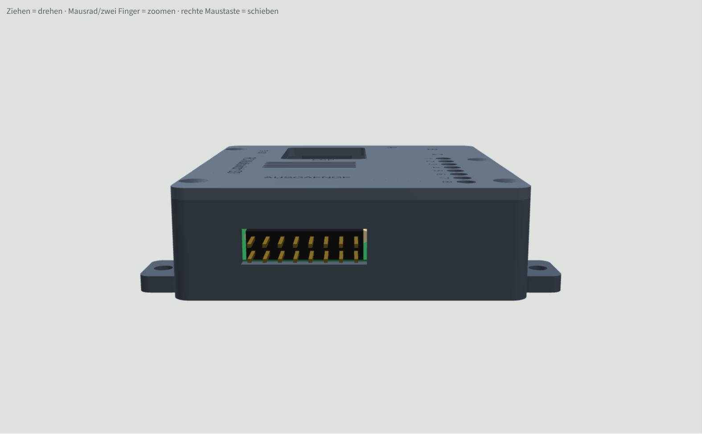

# Gehaeuse fuer RC-Multiswitch-ESP32-S3 (Platine v0.4)

3D-druckbares Gehaeuse aus Unterteil und Deckel. Die Masse stammen aus `hardware/RC-Multiswitch-ESP32-S3.kicad_pcb` (Platine 66,52 x 50,6 mm), die Bauteilhoehen sind Annahmen (siehe unten).


## Dateien
| Datei | Inhalt |
|---|---|
| `Gehaeuse_Unterteil.stl` | Unterteil, druckfertig (Boden aufs Bett) |
| `Gehaeuse_Deckel.stl` | Deckel, druckfertig (schon gedreht, Oberseite aufs Bett) |
| `Gehaeuse_Unterteil.step`, `Gehaeuse_Deckel.step` | zum Weiterbearbeiten in Fusion 360, FreeCAD oder KiCad (Deckel in Einbaulage) |
| `gehaeuse.py` | Quelle (CadQuery), alle Masse als Parameter oben in der Datei |
| `Gehaeuse3D_Vorschau.html` | drehbare 3D-Vorschau mit Platine (im Browser oeffnen) |

## Masse
- Aussen 71,9 x 61,6 x 19,6 mm (mit Deckel), Wand 2,2 mm, Boden und Deckel 2,0 mm.
- 3 mm Platz unter der Platine (Loetstellen), 11 mm ueber der Platine.

## Annahmen
- Der Waveshare ESP32-S3-Zero ist direkt auf einer Stiftleiste eingeloetet (Unterkante 2,5 mm ueber der Platine, bestaetigt). Danach richtet sich der USB-Ausschnitt.
- Hoechste Teile: J1 (8,5 mm) und der Treiber (TBD62083APG/TBD62783APG) im Sockel (ca. 8 mm). JST-PH-Buchsen liegend, ca. 6 mm hoch.
- Lage von BOOT, RESET und RGB-LED auf dem S3-Zero ist nicht in der KiCad-Datei, deshalb ein Fenster ueber dem ganzen Modul.

## Oeffnungen
- Links: USB-C des S3-Zero (aussen mit Tasche fuer dicke Stecker), CN1 UART A, CN2 Last 5-12 V.
- Hinten: J5 UART B und J6 UART C (eine gemeinsame Oeffnung).
- Deckel: Ausschnitt ueber J1 (Ausgaenge 2x8, Stecker von oben), Fenster ueber dem S3-Zero, 8 Lichtloecher fuer die Kontroll-LEDs, 4 Lueftungsschlitze ueber dem Treiber U2, vertiefte Beschriftung.

## Drucken und Montieren
- PETG oder PLA, 0,2 mm Schicht, 3 Wandlinien, 20 % Fuellung, keine Stuetzen noetig.
- Platine: Sie hat keine Montageloecher. Sie liegt ringsum auf einem 1,2 mm breiten Rand und 2 Stuetzen und wird vom Deckel mit 10 kleinen Rippen am Rand festgedrueckt. Keine Schrauben durch die Platine.
- Deckel: 4 x Blechschraube 2,5 x 8 (Senkkopf) in die Dome in der vorderen und hinteren Wand.
- Einbau ins Modell: 4 Laschen am Boden mit 3,4-mm-Loch fuer Schrauben oder Kabelbinder.
- Noch nicht gedruckt und nicht am echten Aufbau geprueft.

## Version mit gewinkelter Stiftleiste (J1 seitlich)
Fuer eine gewinkelte Stiftleiste 2x8, 2,54 mm an J1 statt der stehenden. Die Stecker der 8 Ausgaenge kommen seitlich durch die rechte Wand, der Deckel ist ueber J1 geschlossen.



| Datei | Inhalt |
|---|---|
| `Gehaeuse_Unterteil_gewinkelt.stl` / `.step` | Unterteil mit Schlitz 21,5 x 6,2 mm in der rechten Wand |
| `Gehaeuse_Deckel_gewinkelt.stl` / `.step` | Deckel ohne J1-Ausschnitt, 9 statt 10 Niederhalter-Rippen |
| `Gehaeuse3D_Vorschau_gewinkelt.html` | 3D-Vorschau dieser Version |

- Die Leiste wird in die vorhandenen Loecher von J1 geloetet, der Kunststoffkoerper zeigt zur rechten Platinenkante. Die Platine bleibt unveraendert (gilt fuer NEG und POS).
- Masse nach KiCad-Footprint `PinHeader_2x08_P2.54mm_Horizontal`: Koerper 5,1 mm hoch, steht ca. 0,1 mm ueber die Platinenkante, die Pins ragen ca. 3,4 mm aus der Aussenwand.
- Oben liegen die Ausgaenge (ungerade Pins), unten die gemeinsame Reihe (gerade Pins: NEG = VLOAD, POS = GND).
- Der Schlitz passt fuer 8 Dupont-Stecker 2-polig nebeneinander (je 2,54 x 5,08 mm).
- Aussenmasse und Innenhoehe wie bei der stehenden Version. Hoechstes Teil ist jetzt der Treiber U2 im Sockel.
- Platine zuerst einlegen, dann die Stecker aufstecken.
- Erzeugen: `python gehaeuse.py export --gewinkelt`

## Aendern
Masse in `gehaeuse.py` anpassen und neu erzeugen (Python 3 mit `pip install cadquery`):
```
python gehaeuse.py export
```
Die Dateien landen im Ordner `export`. Mit `--pruefen` wird zusaetzlich die Platine als vereinfachtes Modell erzeugt und auf Ueberschneidungen mit dem Gehaeuse geprueft.
